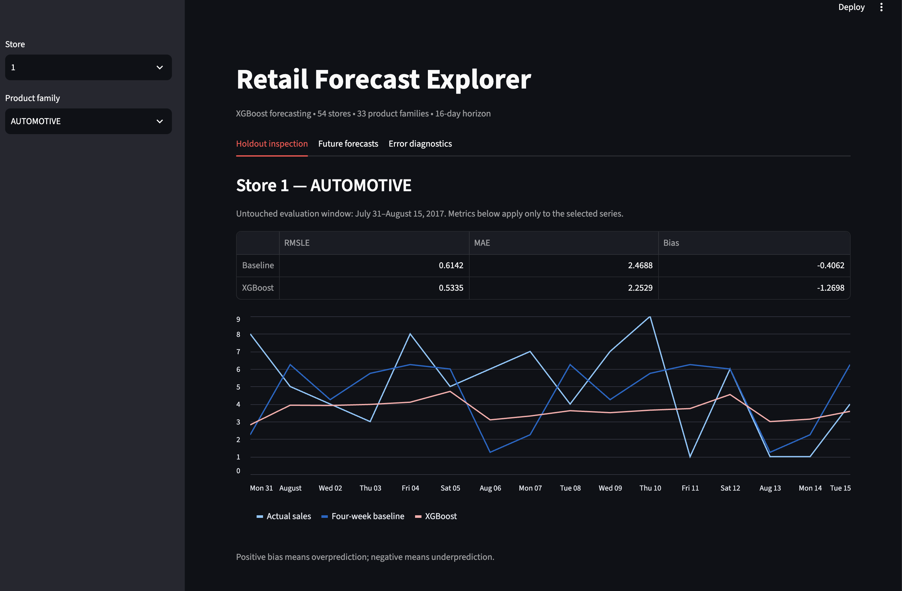
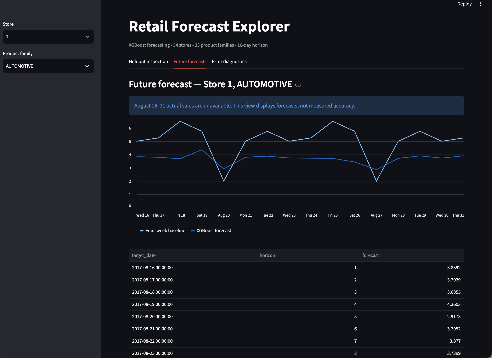
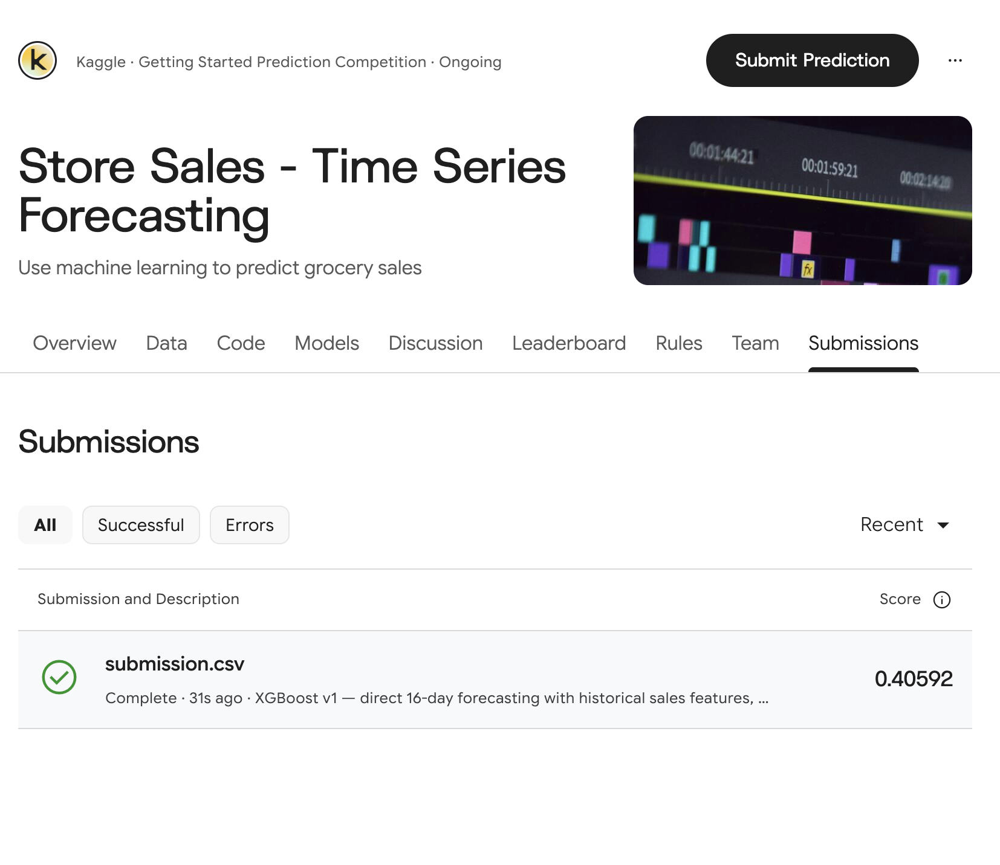

# Retail Demand Forecasting

A local machine-learning project forecasting daily sales across
54 stores and 33 product families over a 16-day horizon.

Built with Python, pandas, scikit-learn, XGBoost, and Streamlit.

## Results

On the final chronological holdout, XGBoost reduced RMSLE by
17.6% and MAE by 7.8% compared with a four-week weekday-average baseline.

| Model | Holdout RMSLE | Holdout MAE | Bias |
|---|---:|---:|---:|
| Four-week weekday average | 0.53113 | 82.2121 | +2.9593 |
| XGBoost v1 | 0.43788 | 75.8240 | +17.1328 |

Positive bias means overprediction. XGBoost improved RMSLE and MAE
but increased average overprediction.

**Kaggle submission RMSLE: 0.40592.**

The Kaggle score and local holdout score evaluate different data
and are reported separately.

## Screenshots

### Holdout evaluation


### Future forecasts


### Kaggle submission


## Dataset

[Kaggle Store Sales — Time Series Forecasting](https://www.kaggle.com/competitions/store-sales-time-series-forecasting/data)

- 3,000,888 training records
- 1,782 store–product-family time series
- Training dates: January 1, 2013–August 15, 2017
- Final forecast dates: August 16–31, 2017
- 28,512 final predictions

Download the competition files from Kaggle and place them in
`data/raw/`. Kaggle may require sign-in and acceptance of competition rules.

The implemented pipeline requires:
- train.csv
- test.csv
- stores.csv
- sample_submission.csv

Oil, holidays, and transaction-count files are not used in version 1.
Raw competition data is not included in this repository.

## Methodology

### Baselines

Compared:
1. Repeating the last observed week across the forecast horizon.
2. Averaging the previous four observations of the target weekday.

### Feature Engineering

- Sales observations relative to the forecast origin
- Rolling means and standard deviations over 7, 14, 28, and 56 days
- Observed-day counts and zero-sales proportions
- Recent weekly sales change
- Four-week target-weekday average
- Forecast horizon and target-date calendar features
- Target-date promotion counts
- Store, family, city, state, type, and cluster

### Model

A single global XGBoost model predicts all series and horizons.
It is trained on `log1p(sales)` using squared-error loss.
Predictions are transformed back with `expm1` and clipped at zero.

Each fit uses 12 historical forecast origins spaced seven days apart:
342,144 training examples. The full raw dataset is available for
history lookup; the model does not train directly on all 3 million rows.

Categorical features are one-hot encoded using training data only.

## Chronological Validation

| Window | Forecast origin | Evaluation dates |
|---|---|---|
| Development fold 1 | June 28, 2017 | June 29–July 14 |
| Development fold 2 | July 14, 2017 | July 15–July 30 |
| Final holdout | July 30, 2017 | July 31–August 15 |

Model and blend selection used only the development folds.
The configuration was fixed before final holdout evaluation.

Each training example's target date must fall on or before the
training cutoff. Sales-history features stop at the forecast origin.

Feature checks verify that changing future sales does not change
the features generated for an earlier origin.

## Local Setup

Developed with Python 3.11 on macOS.

Clone the repository:

```bash
git clone https://github.com/mostafamounib/retail-demand-forecasting.git
cd retail-demand-forecasting
```

Create an environment and install dependencies:

```bash
python3 -m venv .venv
source .venv/bin/activate
python -m pip install -r requirements.txt
```

On macOS, if XGBoost reports a missing `libomp.dylib`, install
the OpenMP runtime with Homebrew:

```bash
brew install libomp
```

Create `data/raw/` and place the required Kaggle CSV files there.

## Reproduce the Workflow

Run these commands in order:

```bash
python baseline_backtest.py
python features.py
python dataset.py
python train_xgb.py
python evaluate_errors.py
python evaluate_blends.py
python evaluate_holdout.py
python forecast_final.py
```

These generate evaluation tables, predictions, and saved model artifacts.
The holdout script reproduces the fixed evaluation; it is not a tuning step.

Launch the local dashboard after generating the output files:

```bash
python -m streamlit run app.py
```

The dashboard displays:
- Holdout actuals versus model and baseline predictions
- Individual store–family metrics
- Future forecasts
- Holdout errors by family and forecast horizon

The dashboard reads generated prediction files. It does not perform
live model inference and requires the workflow outputs to exist.

## Project Files

| File | Purpose |
|---|---|
| baseline_backtest.py | Evaluate seasonal baselines |
| features.py | Build forecast-origin sales features |
| dataset.py | Expand features into 16 forecast horizons |
| train_xgb.py | Train and evaluate development models |
| evaluate_errors.py | Analyze development errors |
| evaluate_blends.py | Compare model–baseline blends |
| evaluate_holdout.py | Evaluate the fixed final candidate |
| forecast_final.py | Retrain, forecast, and save model artifacts |
| app.py | Local Streamlit forecast explorer |
| EXPERIMENTS.md | Experiment results and assumptions |

Generated files are saved under `outputs/` and `models/`.
Large generated artifacts are excluded from version control.

## Limitations

- Forecasts represent observed sales, not unconstrained demand.
- Future promotion counts are assumed known at the forecast origin.
- Missing calendar dates are not automatically treated as zero sales.
- Evaluation covers three summer windows, not all seasons.
- Historical forecast examples overlap and are not independent samples.
- Improved RMSLE does not guarantee lower inventory costs.
- Version 1 produces point forecasts without prediction intervals.
- No stock levels, supplier lead times, or inventory simulation are modeled.
- Saved dependencies reflect the development environment; other platforms
  may require installation adjustments.

## Learning Focus

Time-series validation, leakage prevention, baseline comparison,
feature engineering, model selection, error analysis, and reproducibility.
